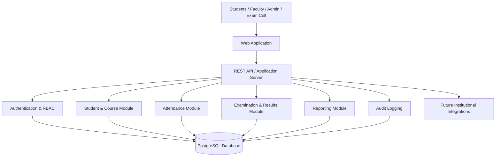

# Initial System Architecture

## Architecture Overview

## Main Components

### Frontend

Responsible for dashboards, forms, navigation, validation feedback, and report views.

### Backend/API

Provides business logic, authorization, validation, data access, and REST endpoints.

### Authentication and RBAC

Controls identity and permissions for students, faculty, administrators, examination staff, and IT support.

### Database

Stores student, course, enrollment, attendance, examination, result, user, and audit information.

### Reporting

Generates academic reports from authorized records.

## Core Data Entities

- User
- Student
- Faculty
- Course
- Enrollment
- Attendance
- Examination
- Result
- AcademicReport
- AuditLog

## Security Boundary

All protected requests should pass authentication and authorization checks before accessing academic records.

## Future Extensions

- Institutional SSO
- Notification service
- External academic systems
- Analytics layer
- Mobile application
